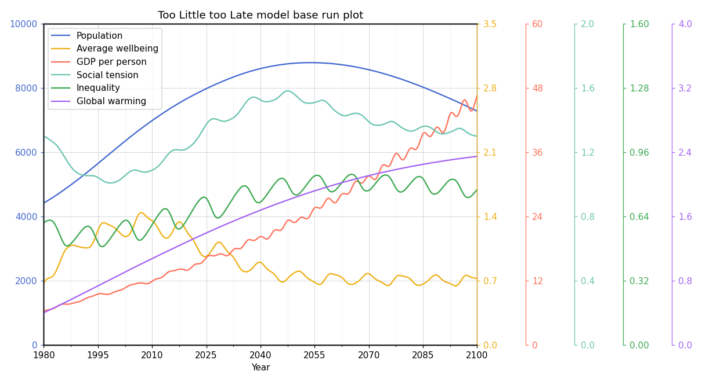
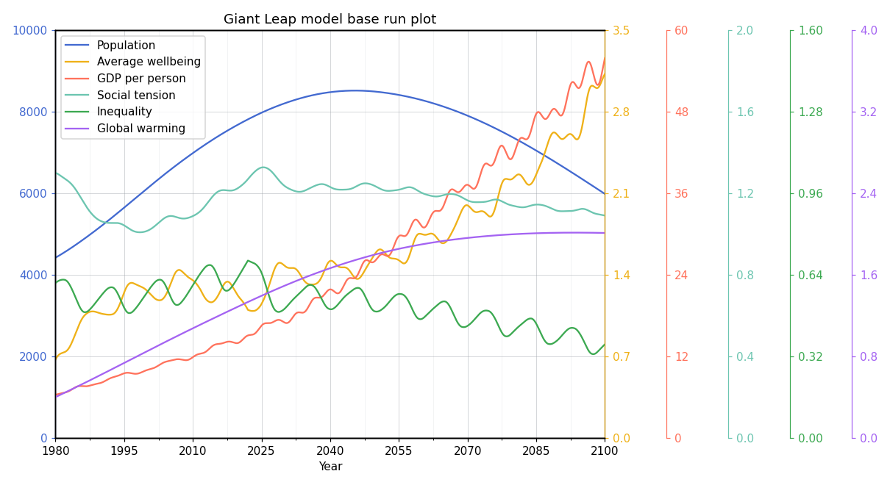
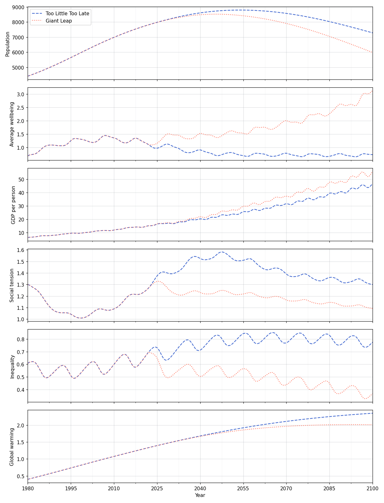

# earth4all

[](https://github.com/HugoFara/earth4all-python/actions/workflows/tests.yml)

A Python implementation of the [Earth4All model](https://earth4all.life/the-science-rp/),
ported from [Earth4All.jl](https://github.com/worlddynamics/Earth4All.jl), which
implements the [April 2023 Vensim version](https://web.archive.org/web/20220830093115/https://earth4all.life/the-science/)
of the model on top of the WorldDynamics framework.

Everything the Julia package does, this one does: the twelve sectors and their
equations, the two scenarios of the book, running a single sector against
tabulated values of the others, the figures, and the comparison with the Vensim
reference runs. The only dependency of the model itself is NumPy; matplotlib is
needed to draw, pandas to export a table, SciPy only for solvers other than
Euler.

## The two scenarios

In *Too Little Too Late* the world keeps doing what it has been doing. In the
*Giant Leap* it carries out five turnarounds — on poverty, inequality,
empowerment, food and energy — which in the model is the same run with a few
parameters changed. Both figures show the six variables the book puts first,
each against its own axis.

| Too Little Too Late | Giant Leap |
| --- | --- |
|  |  |

The same variables with the scenarios drawn on top of each other. Nothing
separates them before 2022, when the turnarounds start:



Population peaks at 8790 million in 2054 and falls to 7283 by 2100 under *Too
Little Too Late*; under the *Giant Leap* it peaks earlier and lower, at 8518
million in 2045, and ends at 5984. Wellbeing is where the two part company
hardest: it drifts sideways in one and more than quadruples in the other, while
warming ends at 2.35 °C against 2.01 °C.

Each of the twelve sectors has a figure of its own as well: **[the gallery](figures/)**
shows all of them, next to what each one is about.

`python scripts/render_figures.py` draws every figure again, after a change to
the model or to the plots, and rewrites the gallery page. Two notebooks go
through the same ground interactively: `examples/two-scenarios.ipynb` for the
scenarios, `examples/sector-gallery.ipynb` for the sectors.

## Running the model

```sh
pip install -e .            # add [dev] for the tests and the plots
```

```python
>>> from earth4all import run_tltl_solution, run_gl_solution
>>> solution = run_tltl_solution()            # Too Little Too Late
>>> solution["pop.POP"][-1]                   # world population in 2100, in millions
7282.516980299024
>>> solution["cli.OW"][-1]                    # observed warming in 2100, in degrees
2.3484525936335094
```

A run integrates the model over 1980–2100 with the explicit Euler method and the
time step of the Vensim model, 1/64 of a year, and takes about two seconds. The
solution holds all 638 variables at all 7681 time points; index it with a
variable, with `"sector.name"`, or with a bare name when it is unambiguous.

The figures of the two base runs:

```python
>>> from earth4all import fig_baserun_tltl, fig_baserun_gl, fig_baserun_comparison
>>> fig_baserun_gl().savefig("giant-leap.png")
```

Or from a shell:

```sh
python -m earth4all gl --plot giant-leap.png --csv giant-leap.csv
```

`examples/two-scenarios.ipynb` walks through both scenarios, builds a third one,
and compares the run with Vensim:

```sh
pip install -e ".[notebook]"
jupyter lab examples/two-scenarios.ipynb
```

### Changing the model

`run_e4a` takes the parameters and the initial values of every sector, so a
scenario is a copy of a sector's parameters with a few of them changed — which
is all `run_gl` is:

```python
>>> from earth4all import demand, run_e4a_solution
>>> parameters = demand.getparameters()
>>> parameters["EETF2022"] = 0.02          # extra empowerment tax from 2022
>>> solution = run_e4a_solution(dem_pars=parameters)
```

### Running one sector

A sector can be run on its own, with the variables the other sectors would have
given it read from tabulated runs of the whole model:

```python
>>> from earth4all import climate
>>> from earth4all.system import solve
>>> solution = solve(climate.climate_run(), (1980, 2100), dt=0.015625)
>>> climate.fig_cli()
```

## How it is laid out

| Module | What is in it |
| --- | --- |
| `earth4all/<sector>/subsystems.py` | the equations, one Vensim equation per line |
| `earth4all/<sector>/parameters.py` | the parameters and `getparameters()` |
| `earth4all/<sector>/initialisations.py` | the initial value of every stock |
| `earth4all/<sector>/tables.py` | the tabulated functions of the sector |
| `earth4all/<sector>/scenarios.py` | running that sector on its own |
| `earth4all/<sector>/plots.py` | its figures |
| `earth4all/scenarios.py` | `run_tltl`, `run_gl`, `run_e4a` |
| `earth4all/solutions.py` | solving them |
| `earth4all/functions.py` | `ramp`, `clip`, `step`, `pulse`, `interpolate`, `smooth`, `delay_n` |
| `earth4all/symbolics.py` | the expressions equations are built from |
| `earth4all/system.py` | composing sectors, ordering equations, integrating |
| `earth4all/validation.py` | comparing a run with the Vensim reference |
| `earth4all/tables.py` | the tabulated runs a single sector needs |

The twelve sectors are climate, demand, energy, finance, foodland, inventory,
labourmarket, other, output, population, public and wellbeing.

### How the equations are solved

The Julia package builds its equations with ModelingToolkit and hands them to
DifferentialEquations. Here, `symbolics.py` records each equation as a small
expression tree, `system.py` sorts the auxiliary equations by dependency and
compiles the whole model into a single Python function, and `solve` steps that
function forward. Sectors are composed the way WorldDynamics composes them: a
variable a sector uses without defining is connected to the variable of the same
name in the sector that defines it.

The upshot is that a sector reads much like its Julia counterpart:

```python
add_equation(eqs, CO2AB, (CO2A - CO2A1850) / LECO2A)
add_equation(eqs, D(CO2A), CO2E - CO2AB + 2 * CO2FCH4)
add_equation(eqs, OWLCO2, ifelse(t > 2022, 1 + SOWLCO2 * (OW / OBWA2022 - 1), 1))
smooth(eqs, PWA, OW, PD)
```

## Agreement with Vensim

`earth4all/validation.py` compares a run with the trajectories Vensim exports,
which the Julia repository keeps in `VensimOutput`. Matching a variable with its
reference series is done through its description, the name it carries in Vensim.

```python
>>> from earth4all import run_tltl
>>> from earth4all.system import solve
>>> from earth4all.validation import all_mre
>>> model = run_tltl()
>>> worst, per_sector = all_mre("TLTL", solve(model, (1980, 2100), dt=0.015625),
...                             model.systems, "../Earth4All.jl/VensimOutput")
```

Over the whole 1980–2100 run, every variable of climate, finance, foodland,
inventory, output, population, public and wellbeing stays within a few percent
of Vensim. Three sectors — demand, energy and labour market — report much larger
relative errors, on a handful of variables that are rates crossing zero: they are
differences of two nearly equal large numbers, so the six digits Vensim exports
are not enough to compare them. Their absolute differences stay small next to the
range each series covers.

## Differences from the Julia package

- The equations, parameters, initial values and scenarios are the same; the
  agreement above was checked equation by equation as well as numerically.
- Three places in the Julia code name a variable that does not exist, and error
  when they are reached. `public_run` connects `GPU`, the variable the Public
  sector reads from Demand, where the Julia code names `GP`. The labour market
  figure draws `UR`, the unemployment rate, where it names `UNRA`. The inventory
  figure names `PI`, which belongs to Finance and so is not in a run of the
  Inventory sector alone; that figure is left with its four other variables.
- Running a single sector uses the tabulated trajectories of `src/tables.jl` by
  default. In the Julia package that file is not loaded by any module, so the
  `_full_support` systems have no tables to read.
- Figures are drawn with matplotlib rather than PlotlyJS.
- Oddities of the Julia code that change results are kept as they are, so that
  the two agree: the extra pension age ramps to `22022` rather than to `2022`,
  and the CO2 in the atmosphere gets twice the CO2 coming from methane. Both are
  marked in the Julia sources too.
- The equations are integrated by the Euler method built into `solve`. Passing
  `method=` any name SciPy knows uses `scipy.integrate.solve_ivp` instead, which
  is worth doing to check how much of a result depends on the time step, but the
  reference runs use Euler.

## Replaying the port

The sector modules were produced from the Julia sources and are meant to be read
and edited from here on. The two scripts that produced them are kept so the port
can be replayed if the Julia package changes:

```sh
python scripts/translate_from_julia.py ../Earth4All.jl
python scripts/convert_support_tables.py ../Earth4All.jl
```

## Tests

```sh
python -m pytest
```

The tests that compare with Vensim are skipped when the Julia repository is not
next to this one.

## Credit

The model is the work of the Earth4All initiative; the implementation this port
follows is Earth4All.jl, by Pierluigi Crescenzi, Aurora Rossi, Emanuele Natale
and contributors, published under the MIT licence.

- Pierluigi Crescenzi, Aurora Rossi, Emanuele Natale. *An open source
  implementation of the Earth4All integrated assessment model.* 2023.
  [hal-04293350](https://hal.science/hal-04293350)
- Pierluigi Crescenzi, Giorgio Gambosi, Lucia Nasti, Emanuele Natale, Aurora
  Rossi. [*A sensitivity analysis of the Earth for all model.*](https://onlinelibrary.wiley.com/doi/10.1111/jiec.13582)
  Journal of Industrial Ecology, 2024.
