# Figures

Drawn by `python scripts/render_figures.py`, from the model in this repository.

Units are the ones the model carries: `Mp` is millions of people, `G$` a billion
dollars, `Mha` a million hectares, `Gcu` a billion capacity units, and `(1)` a
quantity that has no unit at all — a share, a ratio, or an index.

## The two scenarios

| Too Little Too Late | Giant Leap |
| --- | --- |
|  |  |

The same six variables with the scenarios drawn on top of each other:

## The twelve sectors

Each sector is run on its own here, with the variables the other eleven would
have given it read from tabulated runs of the whole model, which is what
`<sector>.<name>_run()` composes. Every figure is the one its `fig_*` function
draws, with the vertical axes shown.

### Climate

Warming, the gases behind it, and the ice left.

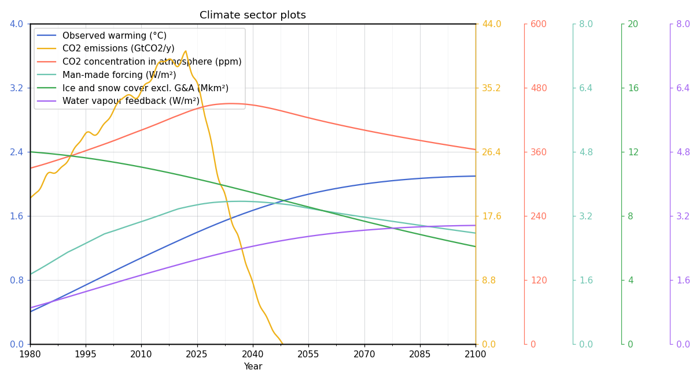

### Demand

How output is split between consumption, savings and the state, and how much debt households and governments carry.

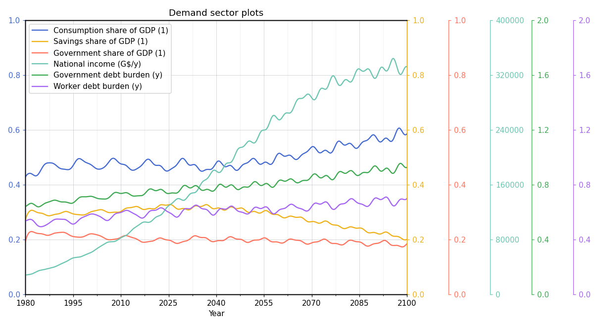

### Energy

The cost of the energy the world uses.

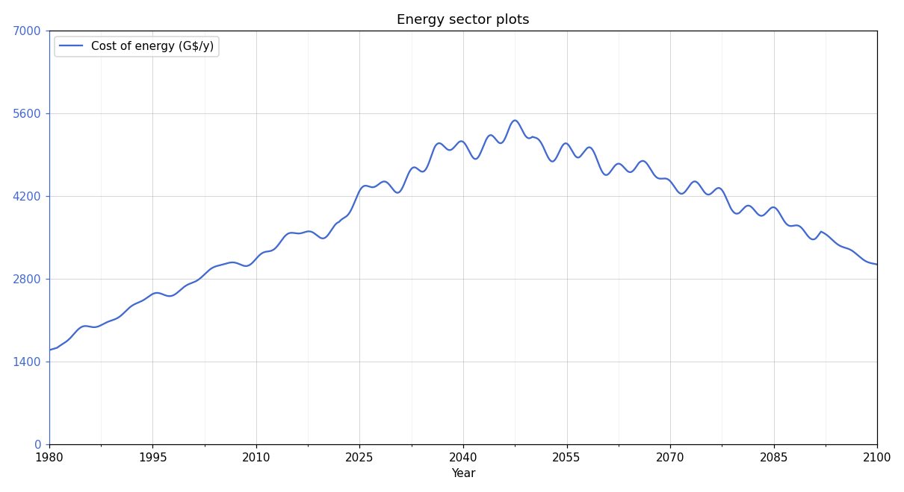

### Finance

The signal rate the central bank sets and the borrowing costs that follow it, over the two decades around 2020.

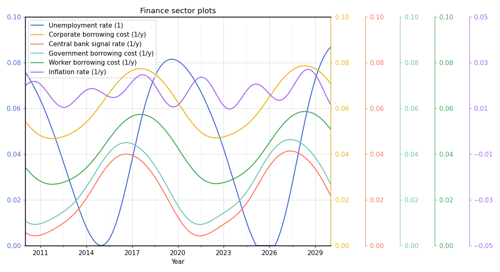

### Food and land

Cropland, what is grown on it, the fertiliser it takes, and the land left to regenerate.

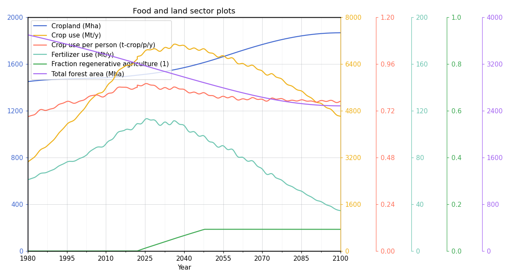

### Inventory

Stocks against desired stocks, and the inflation that comes of the gap.

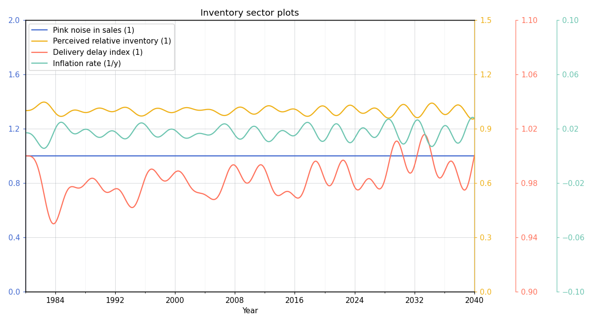

### Labour market

The size of the workforce, its share of output, and unemployment.

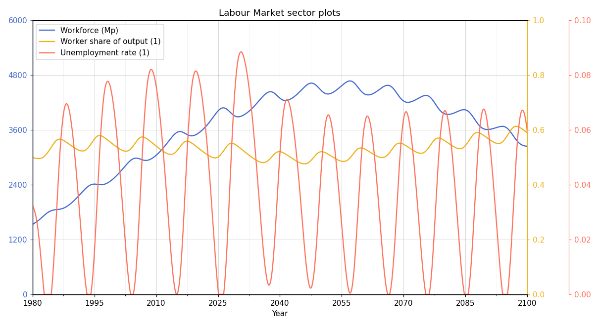

### Other

The cost of the turnarounds, the people below the poverty line, and the growth of output per person.

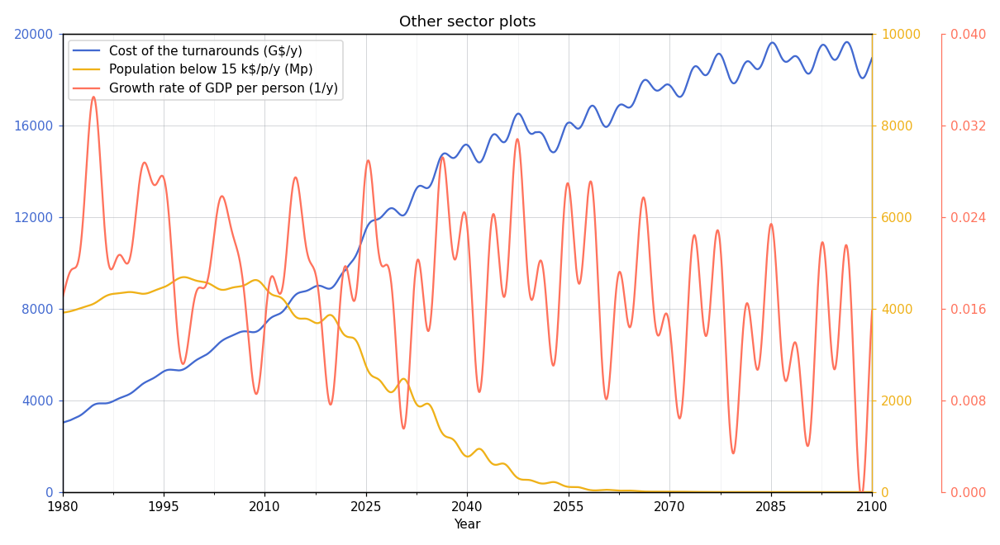

### Output

The capital stock in private and public hands, and the output it yields.

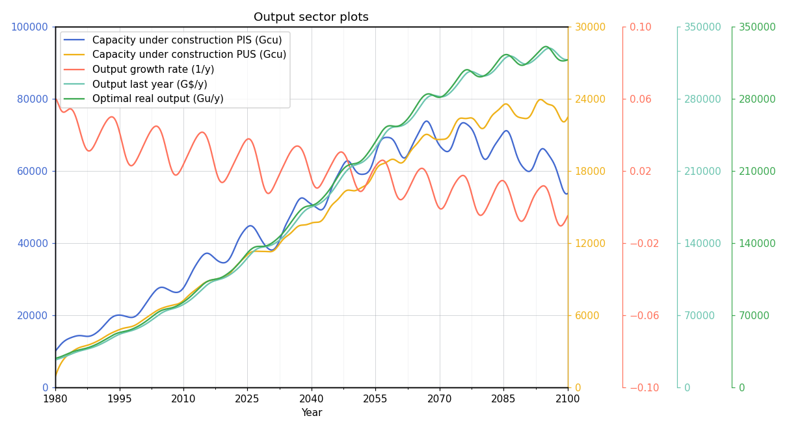

### Population

Births, life expectancy past sixty, and the population that results.

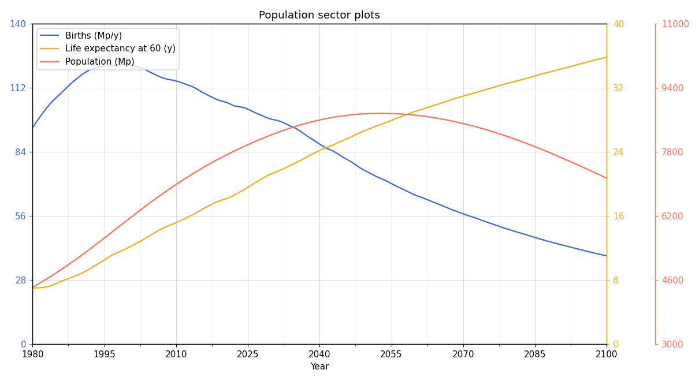

### Public

Public spending, the tax that funds it, and the productivity it buys.

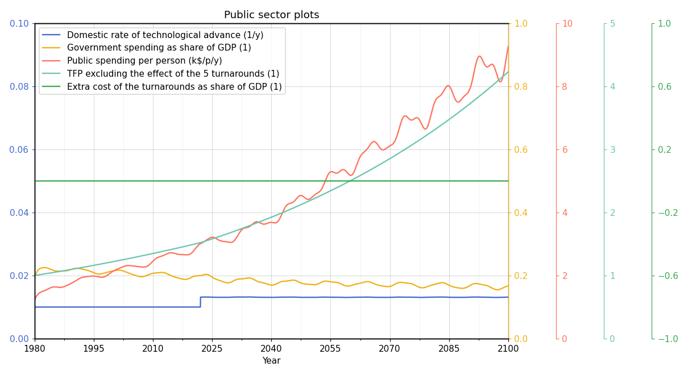

### Wellbeing

The average wellbeing index, which the whole model is built to explain.

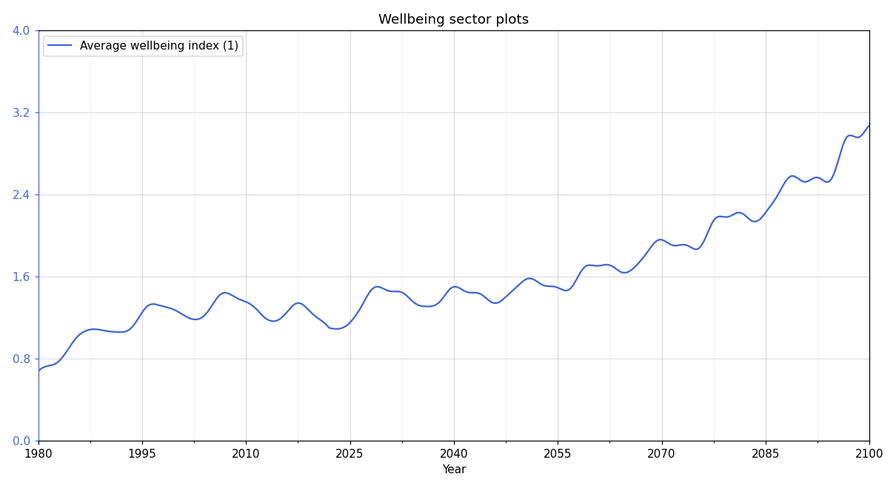
